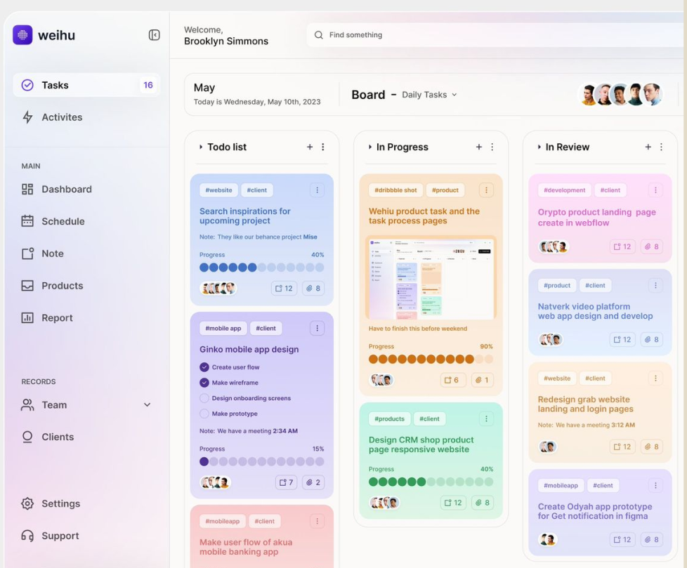
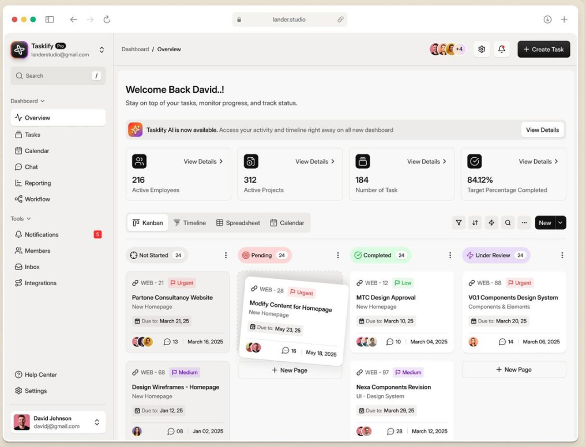
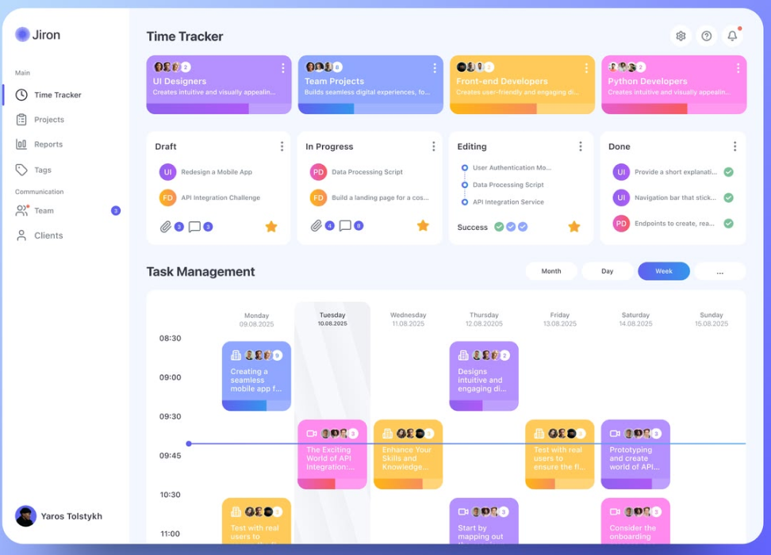

# CLAUDE.md — ideavellum

Bu dosya, ideavellum projesinde çalışan Claude Code için ana rehberdir. Her oturumun başında bunu oku. Tasarım ilhamı görselleri `docs/inspiration/` klasöründedir; arayüz işine başlamadan önce onları da aç ve incele.

---

## 1. Proje nedir?

**ideavellum**, kişinin kendi hayatını bir üniversite dönemi gibi programlamasını sağlayan kişisel bir "öğrenme işletim sistemi"dir. Kullanıcı kendine dersler açar, haftalık ders saatlerini girer, konuları ve görevleri takip eder, derse ait notları ve kaynakları (izlediği video, okuduğu kitap/makale) o dersin altında toplar. Uygulama ders saati gelince zil çalar, telefona bildirim, e-postaya hatırlatma ve özet gönderir. Biten dersler bir "transkript"te arşivlenir, raporlarda ilerleme görünür.

Ürün hissi: Trello'nun sürükle-bırak rahatlığı + Odoo/proje yönetimi araçlarının yapısı, ama **minimal, sakin ve tek kişilik** bir deneyim. Ekip, rol, izin karmaşası yok.

**Kullanıcı:** Tek kişi (proje sahibi Murat). İleride çok kullanıcılı olabilir, bu yüzden veri modeli baştan `user_id` ile kurulur ama ekip özellikleri yapılmaz.

**Başarı ölçütü:** Murat sabah uygulamayı açtığında 3 saniye içinde "şu an hangi dersteyim, sırada ne var, bugün ne yapmam gerekiyor" sorularının cevabını görebilmeli.

---

## 2. Proje sahibiyle çalışma kuralları (çok önemli)

- **Murat kod bilmiyor.** Figma'yı çok iyi bilen bir arayüz tasarımcısı; ürünü yapay zekâ araçlarıyla üretiyor. Teknik kararları sen ver; ona teknik soru sorma ("Prisma mı Drizzle mı?" gibi). Gerekçeyi tek cümleyle açıkla.
- **Seçenek listesi sunma, tek net öneri yap.** Gerçekten bir ürün kararı gerekiyorsa (ör. "biten görevler 30 gün sonra arşive mi gitsin?") tek soru sor ve önerdiğin cevabı da yaz.
- **Her zaman Türkçe ve sade dille konuş.** Terim kullanman gerekirse yanında ne işe yaradığını yaz.
- **Somut örnekle anlat.** Bir şeyi açıklarken "örneğin 'İngilizce B2' dersine Salı 19:00 slotu eklediğinde…" gibi gerçek bir senaryo kullan.
- **Her adım sonunda test talimatı ver:** Tarayıcıda hangi adrese gideceğini, neye tıklayacağını, ne görmesi gerektiğini madde madde yaz.
- **Ortam değişkenleri ve hesaplar:** Bir API anahtarı gerekiyorsa (Supabase, Resend, VAPID vb.) nereden alınacağını, hangi menüye tıklanacağını adım adım anlat. Anahtarları asla koda yazma, sadece `.env.local` kullan.
- **Küçük ve çalışır adımlarla ilerle.** Her alt görev bitince uygulama çalışır durumda olmalı ve anlamlı bir mesajla git commit atılmalı.
- **Görsel kalite kritik.** Murat piksel hatalarını, tutarsız boşlukları ve hizasız öğeleri fark eder. Arayüz değişikliklerinden sonra ekran görüntüsü alıp kendin kontrol et.

---

## 3. Teknoloji yığını (karar verildi, değiştirme)

| Katman | Seçim | Neden |
|---|---|---|
| Framework | **Next.js (App Router) + React + TypeScript (strict)** | Tek kod tabanında hem arayüz hem sunucu tarafı |
| Stil | **Tailwind CSS v4** | shadcn/ui ile doğal uyum |
| Bileşenler | **shadcn/ui** (Radix tabanlı) | Murat'ın istediği modern, erişilebilir temel |
| İkonlar | **lucide-react** | shadcn varsayılanı |
| Veritabanı + Auth | **Supabase** (Postgres, Auth, Row Level Security) | Hazır giriş sistemi, cron, ücretsiz başlangıç |
| Veri erişimi | **@supabase/ssr + supabase-js**, tipler `supabase gen types` ile | Ek ORM katmanı yok, daha az hareketli parça |
| Sürükle-bırak | **@dnd-kit/core + @dnd-kit/sortable** | Kanban ve takvim için en esnek kütüphane |
| Sıralama | **fractional-indexing** | Kart taşırken tüm listeyi yeniden numaralamamak için |
| Not editörü | **Tiptap** (StarterKit + TaskList + Link + Placeholder) | Zengin metin, içerik JSON olarak saklanır |
| Grafikler | **shadcn charts (Recharts)** | Raporlar için |
| Formlar | **react-hook-form + zod** | Doğrulama tek yerde |
| Tarih/saat | **date-fns + date-fns-tz**, `tr` locale | Türkçe tarih ve Europe/Istanbul saat dilimi |
| İstemci durumu | **zustand** (sadece zamanlayıcı ve UI tercihleri için) | Hafif |
| Bildirim (toast) | **sonner** | shadcn uyumlu |
| PWA + Push | **Serwist** (service worker) + **web-push** (VAPID) | Telefona bildirim |
| E-posta | **Resend + React Email** | Şablonlu, güvenilir gönderim |
| Zamanlanmış işler | **Supabase pg_cron + pg_net** → Next.js `/api/cron/*` | Dakikalık hatırlatma tetikleme |
| AI (opsiyonel, Faz 6) | **Anthropic API**, model adı `.env`'den | Özellik bayrağıyla kapatılabilir |
| Paket yöneticisi | **pnpm** | |
| Yayın | **Vercel** (uygulama) + **Supabase Cloud** (veri) | |

---

## 4. Sözlük (arayüzde kullanılacak Türkçe terimler)

Arayüz metinleri Türkçe; kod, tablo, değişken ve dosya adları İngilizce.

| Arayüz (TR) | Kod (EN) | Anlamı |
|---|---|---|
| Dönem | `term` | Belirli tarih aralığındaki ders paketi (ör. "2026 Güz") |
| Ders | `course` | Öğrenilecek ana alan (ör. "İngilizce B2", "Lacan'a Giriş") |
| Konu | `topic` | Dersin ünitesi/başlığı, sıralı |
| Ders saati | `class_session` | Haftalık tekrar eden program slotu (Salı 19:00–20:30) |
| Yoklama | `attendance` | O günkü ders saatine "katıldım / kaçırdım / erteledim" kaydı |
| Zil | `bell` | Ders başlangıç/bitiş/teneffüs uyarısı (ses + bildirim) |
| Görev | `task` | Yapılacak iş; derse/konuya bağlı olabilir ya da bağımsız |
| Not | `note` | Derse/konuya ait zengin metin not |
| Kaynak | `resource` | Video, kitap, makale, podcast, kurs vb. |
| Çalışma oturumu | `study_log` | Harcanan süre kaydı (zamanlayıcı ya da elle) |
| Transkript | — (görünüm) | Tamamlanmış derslerin arşivi ve değerlendirmesi |
| Rapor | — (görünüm) | Haftalık/aylık özetler ve grafikler |

Görev durumları: **Yapılacak** (`todo`) → **Devam ediyor** (`in_progress`) → **Gözden geçir** (`review`) → **Bitti** (`done`).

---

## 5. Ekranlar ve özellikler

### 5.1 Uygulama iskeleti
- Sol kenar çubuğu (daraltılabilir): Bugün, Ders programı, Pano, Dersler, Notlar, Kaynaklar, Raporlar, Transkript; altta Ayarlar.
- Kenar çubuğunda aktif dönemin dersleri renk noktalarıyla listelenir (bkz. ilham 04).
- Üst çubuk: arama / komut paleti (`Ctrl/Cmd + K`, shadcn `Command`), **Hızlı ekle** butonu (görev, not, kaynak).
- Mobilde kenar çubuğu alt sekme çubuğuna dönüşür: Bugün, Program, Pano, Dersler, Daha fazla.

### 5.2 Bugün (ana ekran)
- **Şu an / sıradaki ders kartı:** dersin rengiyle, canlı geri sayım ("Başlamasına 12 dk" / "Bitmesine 34 dk"), tek tıkla yoklama ve çalışma zamanlayıcısını başlatma.
- **Bugünün programı:** dikey zaman çizelgesi, şu anki saati gösteren çizgi.
- **Bugünün görevleri:** son tarihi bugün veya geçmiş olanlar; tik atınca `done` olur.
- **Hızlı not** alanı: yazılan not seçili derse kaydedilir.
- Üstte küçük özet şeridi: bugün çalışılan süre, tamamlanan görev, seri (art arda kaç gün çalışıldı).

### 5.3 Ders programı
- Haftalık takvim görünümü (Pazartesi başlar), 07:00–24:00 aralığı, 15 dakikalık ızgara (bkz. ilham 03).
- Ders saatleri dersin renginde bloklar; **sürükleyerek taşınır, alt kenardan çekerek uzatılır.**
- Boş alana tıklayınca "Ders saati ekle" diyaloğu (ders, gün, başlangıç, bitiş, yer, zil ayarları).
- Gün / Hafta / Ay geçişi. Bugün sütunu vurgulu, şu anki saat çizgisi görünür.
- Geçmiş bloklarda yoklama durumu ikonla görünür.

### 5.4 Pano (Kanban)
- Dört sütun: Yapılacak, Devam ediyor, Gözden geçir, Bitti. Sütunlar arası ve sütun içi sürükle-bırak (bkz. ilham 01, 02).
- Filtreler: ders, konu, öncelik, son tarih. Görünüm değiştirici: Pano / Liste / Takvim.
- Kart içeriği: ders etiketi (renkli), başlık, varsa kontrol listesi ilerlemesi, son tarih, öncelik bayrağı.
- Karta tıklayınca sağdan açılan panel (`Sheet`): açıklama, kontrol listesi, bağlı konu, notlar, hatırlatma.
- "Bitti" sütunu 14 günden eski kartları otomatik gizler (Transkript/rapordan erişilir).

### 5.5 Dersler ve ders detay sayfası
- Ders listesi: renkli kartlar, ilerleme çubuğu (tamamlanan konu oranı), haftalık süre.
- **Ders detayı** üstte renkli başlık alanı (bkz. ilham 04): ders adı, dönem, başlangıç, hedef bitiş, toplam çalışma süresi.
- Sekmeler: **Genel bakış · Konular · Görevler · Notlar · Kaynaklar · Çalışma geçmişi**
  - Konular: sürükle-bırak sıralanabilir liste, her konuya durum ve tamamlanma tarihi.
  - Kaynaklar: tür ikonuyla liste, durum (izlenecek/okunacak → devam ediyor → bitti), ilerleme (sayfa/dakika), puan, kısa özet.
  - Notlar: Tiptap editörü, sabitleme, konuya bağlama.
- "Dersi tamamla" aksiyonu: kapanış değerlendirmesi (ne öğrendim, kendime not, 1–5 puan) ister ve dersi Transkript'e taşır.

### 5.6 Notlar ve Kaynaklar (genel görünümler)
- Tüm derslerin notları/kaynakları tek yerde, derse göre filtrelenebilir ve aranabilir.

### 5.7 Raporlar
- Haftalık ve aylık özet: ders bazında çalışma süresi (çubuk grafik), tamamlanan görev/konu, yoklama oranı, seri takvimi (GitHub tarzı ısı haritası).
- "Bu hafta" kartında hedef vs. gerçekleşen süre.

### 5.8 Transkript
- Tamamlanmış dersler: dönem, süre, tamamlanan konu sayısı, kendi verdiği puan, kapanış notu. Ders kartından tüm arşivlenmiş içeriğe erişilir.

### 5.9 Ayarlar
- Profil, saat dilimi (varsayılan Europe/Istanbul).
- **Zil ayarları:** ders öncesi uyarı (varsayılan 5 dk), başlangıç zili, bitiş zili, ses seçimi, sessiz saatler.
- **Bildirim kanalları:** uygulama içi, telefon (push), e-posta — her olay türü için ayrı açıp kapatma.
- E-posta: sabah özeti saati (varsayılan 07:30), haftalık rapor günü (varsayılan Pazar 20:00).
- AI asistan aç/kapat (Faz 6).

---

## 6. Veri modeli (Supabase / Postgres)

Tüm tablolarda `id uuid primary key default gen_random_uuid()`, `user_id uuid references auth.users not null`, `created_at`, `updated_at`. **Her tabloda RLS açık ve politika `user_id = auth.uid()`.** Şema değişiklikleri `supabase/migrations/` altında SQL migration olarak yazılır.

```
profiles            (id = auth.users.id, full_name, timezone, locale, bell_settings jsonb, notification_prefs jsonb)
terms               (name, start_date, end_date, is_active)
courses             (term_id, name, code, color, description, goal, status[active|paused|completed|dropped],
                     target_weekly_minutes, completed_at, final_reflection, final_rating)
topics              (course_id, title, position, status[not_started|in_progress|done], done_at)
class_sessions      (course_id, weekday 1-7, start_time, end_time, location, valid_from, valid_until, bell_overrides jsonb)
attendance          (class_session_id, date, status[attended|missed|postponed], note)   unique(class_session_id, date)
tasks               (course_id?, topic_id?, title, description, status[todo|in_progress|review|done],
                     priority[low|medium|high|urgent], due_at, position text, completed_at)
task_checklist_items(task_id, label, is_done, position)
notes               (course_id?, topic_id?, title, content jsonb, is_pinned)
resources           (course_id?, topic_id?, type[video|book|article|podcast|course|other], title, url, author,
                     status[queued|in_progress|done], progress_current, progress_total, unit[page|minute|chapter],
                     rating, summary)
study_logs          (course_id?, topic_id?, started_at, ended_at, duration_minutes, source[timer|manual|session])
reminders           (kind[bell_before|bell_start|bell_end|task_due|daily_digest|weekly_report|custom],
                     entity_type, entity_id, fire_at timestamptz, channels text[], status[pending|sent|failed|cancelled], sent_at)
push_subscriptions  (endpoint, p256dh, auth, user_agent)
notification_log    (reminder_id, channel, status, error, sent_at)
```

Kurallar:
- Saatler veritabanında `timestamptz` (UTC) olarak saklanır; gösterimde kullanıcının saat dilimine çevrilir. `class_sessions` için `time` + kullanıcı saat dilimi kullanılır.
- `position` alanları fractional index (metin) tutar.
- Ders renkleri serbest hex değil, tasarım sistemindeki ders paletinin anahtarıdır (`"lavender"`, `"mint"` …).

---

## 7. Bildirim ve zil mimarisi

Üç katman birlikte çalışır:

1. **Uygulama içi zil (uygulama açıkken):** İstemci, yaklaşan zil olaylarını hesaplar; zamanı gelince `/public/sounds/` altındaki sesi çalar ve `sonner` ile bildirim gösterir. Tarayıcı otomatik ses çalmayı engellediği için ilk açılışta "Zil seslerini etkinleştir" butonu gösterilir.
2. **Telefon bildirimi (Web Push):** Uygulama PWA olarak yüklenir (manifest + Serwist service worker). Kullanıcı izin verince `push_subscriptions` tablosuna kaydedilir. iPhone'da push yalnızca uygulama "Ana Ekrana Ekle" ile yüklendiyse çalışır; Ayarlar ekranında bunu anlatan kısa bir yönerge göster.
3. **E-posta:** Resend + React Email şablonları: sabah özeti, haftalık rapor, gecikmiş görev uyarısı.

**Zamanlayıcı akışı:**
- Ders saati eklendiğinde/değiştiğinde önümüzdeki **14 günün** zil hatırlatmaları `reminders` tablosuna üretilir; eski bekleyenler iptal edilir.
- Görev son tarihi verildiğinde `task_due` hatırlatması üretilir.
- Supabase `pg_cron` her dakika `pg_net` ile `POST /api/cron/dispatch` çağırır (başlıkta `CRON_SECRET`). Bu uç nokta `fire_at <= now()` ve `status = pending` kayıtları alır, kanallara gönderir, `notification_log`'a yazar.
- Her gece 03:00'te `/api/cron/extend` 14 günlük pencereyi ileri kaydırır ve günlük/haftalık e-posta hatırlatmalarını üretir.
- Sessiz saatlerde push/e-posta gönderilmez, uygulama içi kayıt tutulur.

---

## 8. Tasarım yönü

### 8.1 Görsel kimlik
"Vellum" ince, yarı saydam parşömen kâğıdı demek. Arayüzün kişiliği buradan gelir: **sakin, kâğıt gibi hafif yüzeyler** üzerinde **her derse ait yumuşak pastel bir renk**. Uygulamanın tek cesur öğesi ders renkleridir; geri kalan her şey nötr ve disiplinli kalır. Renk bir süs değil bilgi taşır: kartın, takvim bloğunun, etiketin hangi derse ait olduğunu anlık söyler.

### 8.2 Tokenlar (başlangıç — `app/globals.css` içinde CSS değişkeni olarak)

Nötrler (açık tema):
- `--surface-page`: `#F6F6F3` (hafif sıcak kâğıt grisi)
- `--surface-card`: `#FFFFFF`
- `--surface-sunken`: `#EEEEEA`
- `--ink`: `#1D1D21` (metin)
- `--ink-muted`: `#6B6B73`
- `--line`: `#E4E4DF`
- `--accent`: `#1C1917` sıcak mürekkep siyahı (birincil buton, aktif menü; koyu temada `#F5F5F4`); odak halkası `--focus` `#A8A29E`. Eski indigo `#4F46E5`, Murat'ın isteğiyle shadcn tarzı nötr bir birincile çevrildi.

Ders paleti (her biri `bg` / `fg` / `solid` üçlüsü; `bg` kart zemini, `fg` kart metni, `solid` ilerleme çubuğu ve takvim kenarı):
- `lavender` `#EEEAFE` / `#4C3A9E` / `#7C6CF2`
- `sky` `#E3F0FD` / `#1F5A94` / `#4A90E2`
- `mint` `#DFF5EA` / `#1D6B47` / `#34B37A`
- `peach` `#FFEBDD` / `#9A4A15` / `#F08A3C`
- `rose` `#FDE4EC` / `#9C2A55` / `#E2588A`
- `butter` `#FDF4D3` / `#7D6210` / `#E3B524`
- `sage` `#E8EFE2` / `#47613A` / `#7E9E6B`
- `slate` `#E9ECF1` / `#3B4558` / `#6B7A93`

Koyu tema her token için ayrıca tanımlanır (ders `bg` renkleri koyu temada %16 opaklıkta `solid` olur).

Tipografi:
- Arayüz yazı tipi: **Onest** (Google Fonts, Türkçe karakterleri tam destekler). Rakamlarda `font-variant-numeric: tabular-nums` (saatler ve sayaçlar kaymasın).
- Ölçek: 12 / 13 / 14 (gövde) / 16 / 20 / 24 / 32. Başlıklar 600, gövde 400, etiketler 500.
- Büyük harfli etiket kullanma; tüm metinler cümle düzeninde.

Biçim:
- Köşe yarıçapı hiyerarşiye göre: küçük öğe 8px, kart 14px, büyük panel/modal 20px.
- Gölge minimum: kartlar zemin rengi farkı ve 1px çizgiyle ayrılır; gölge sadece sürüklenen kartta ve açılan panelde.
- Boşluk ölçüsü 4'ün katları; kart iç boşluğu 16px, sütun arası 16px.
- Hareket: sadece kullanıcı eylemine cevap olarak (sürükleme, panel açma, tamamlama). Tamamlanan görevde kısa bir tik animasyonu tek "keyif anı" olsun. `prefers-reduced-motion` desteklenir.

### 8.3 Kalite tabanı
- Mobil uyumlu (360px'e kadar), klavye ile tam kullanılabilir, görünür odak halkası, WCAG AA kontrast.
- Boş durumlar yönlendirici olmalı: "Henüz ders yok. İlk dersini ekleyerek döneme başla." + buton.
- Buton metinleri eylemi söyler: "Ders saati ekle", "Görevi tamamla" — "Gönder", "Tamam" değil.

---

## 9. İlham görselleri

Görseller `docs/inspiration/` klasöründe. Birebir kopyalanmaz; aşağıdaki çıkarımlar uygulanır.

### 01 — Renkli kanban


- **Al:** Her kartın kategorisine göre pastel zemin ve aynı tonda koyu metin → ders paleti mantığı. Kart içinde kontrol listesi ve nokta tarzı ilerleme göstergesi. Sütun başlığında `+` ve menü.
- **Alma:** Kart başına iki-üç etiket kalabalığı; kişi avatarları (tek kullanıcılı uygulama).

### 02 — Sade dashboard


- **Al:** Nötr, ferah düzen ve net hiyerarşi. Üstte özet sayı şeridi (Bugün ekranındaki özet). **Pano / Zaman çizelgesi / Tablo / Takvim** görünüm değiştirici. Sütun başlığında durum rozeti + sayaç. Sürüklenen kartın hafif eğilip gölgelenmesi.
- **Alma:** Kurumsal metrikler (çalışan sayısı vb.), çok sayıda ikon buton.

### 03 — Haftalık takvim


- **Al:** Ders programı ekranının ana referansı. Gün sütunları, saat ızgarası, renkli bloklar, **şu anki saati gösteren yatay çizgi**, vurgulu bugün sütunu, Ay/Gün/Hafta geçişi. Üstteki durum sütunları (Taslak / Devam / Bitti) özet kartları için fikir verir.
- **Alma:** Çok doygun, gradyanlı blok renkleri; bizim bloklarımız pastel zemin + sol kenarda `solid` şerit olacak.

### 04 — Proje detay


- **Al:** Ders detay sayfasının referansı. Üstte renkli başlık alanı + meta bilgiler (oluşturma, hedef tarih, takip edilen süre). Sekme çubuğu (Genel bakış / Liste / Pano / Takvim). Kenar çubuğunda gruplu, renk noktalı proje listesi → dönem altında dersler. Sağ panelde zaman grafiği → ders bazlı haftalık çalışma süresi.
- **Alma:** Ekip sohbeti; sağ panel ileride AI asistan alanı olarak düşünülebilir (Faz 6).

---

## 10. Klasör yapısı

```
ideavellum/
├─ CLAUDE.md
├─ docs/
│  └─ inspiration/            # tasarım ilhamı görselleri
├─ public/
│  ├─ sounds/                 # zil sesleri (bell-soft.mp3, bell-classic.mp3, chime.mp3)
│  └─ icons/                  # PWA ikonları
├─ supabase/
│  └─ migrations/             # SQL şema ve RLS
├─ src/
│  ├─ app/
│  │  ├─ (auth)/giris/
│  │  ├─ (app)/
│  │  │  ├─ bugun/
│  │  │  ├─ program/
│  │  │  ├─ pano/
│  │  │  ├─ dersler/[courseId]/
│  │  │  ├─ notlar/
│  │  │  ├─ kaynaklar/
│  │  │  ├─ raporlar/
│  │  │  ├─ transkript/
│  │  │  └─ ayarlar/
│  │  ├─ api/cron/{dispatch,extend}/route.ts
│  │  ├─ manifest.ts
│  │  └─ sw.ts                # Serwist service worker
│  ├─ components/
│  │  ├─ ui/                  # shadcn bileşenleri (elle düzenleme minimum)
│  │  ├─ layout/              # sidebar, topbar, mobile-nav
│  │  ├─ board/  schedule/  course/  notes/  resources/  reports/  today/
│  ├─ lib/
│  │  ├─ supabase/            # server, client, middleware yardımcıları
│  │  ├─ reminders/           # hatırlatma üretimi ve gönderimi
│  │  ├─ notifications/       # push, email, bell
│  │  ├─ dates.ts             # saat dilimi ve tr locale yardımcıları
│  │  └─ course-colors.ts     # ders paleti
│  ├─ emails/                 # React Email şablonları
│  ├─ server/actions/         # Server Actions (alan bazlı dosyalar)
│  └─ types/database.ts       # supabase gen types çıktısı
└─ .env.local                 # git'e girmez
```

URL'ler Türkçe ve sade (`/bugun`, `/program`, `/pano`, `/dersler/...`).

---

## 11. Kod kuralları

- Veri okuma Server Component'lerde, yazma Server Actions ile. Sürükle-bırak gibi anlık etkileşimlerde **iyimser güncelleme** (`useOptimistic`), hata olursa geri al ve toast göster.
- Her Server Action girdisini zod ile doğrular ve `user_id`'yi asla istemciden almaz, oturumdan alır.
- Bileşenler küçük ve tek amaçlı; 200 satırı geçen dosyayı böl.
- shadcn bileşenlerini `components/ui` içinde özelleştir, uygulama bileşenleri onları sarmalasın.
- Tarih biçimleri: `d MMMM yyyy, EEEE` → "4 Kasım 2026, Çarşamba"; saat 24 saat biçiminde.
- Haftanın ilk günü Pazartesi.
- Erişilebilirlik: sürükle-bırak için dnd-kit klavye sensörü açık; her ikon butonda `aria-label`.
- Ortam değişkenleri `src/lib/env.ts` içinde zod ile doğrulanır.

Ortam değişkenleri:
```
NEXT_PUBLIC_SUPABASE_URL=
NEXT_PUBLIC_SUPABASE_ANON_KEY=
SUPABASE_SERVICE_ROLE_KEY=
NEXT_PUBLIC_VAPID_PUBLIC_KEY=
VAPID_PRIVATE_KEY=
VAPID_SUBJECT=mailto:
RESEND_API_KEY=
EMAIL_FROM=
CRON_SECRET=
APP_URL=
# Faz 6
AI_ENABLED=false
ANTHROPIC_API_KEY=
ANTHROPIC_MODEL=
```

---

## 12. Yol haritası

Her faz sonunda Murat'a test talimatı ver ve onay almadan sonraki faza geçme.

**Faz 0 — Kurulum ve iskelet**
Next.js + TypeScript + Tailwind + shadcn kurulumu, Onest yazı tipi, tasarım tokenları, Supabase bağlantısı, e-posta ile giriş (magic link), kenar çubuğu + üst çubuk + mobil alt menü, boş sayfalar.

**Faz 1 — Dönem, dersler, konular, ders programı**
Dönem ve ders oluşturma (renk seçici ders paletinden), konu listesi (sürükle-bırak sıralama), haftalık ders programı görünümü (blok ekleme, taşıma, uzatma), ders detay sayfası iskeleti.

**Faz 2 — Görevler, Pano ve Bugün ekranı**
Görev CRUD, kontrol listesi, kanban sürükle-bırak, filtreler, görev detay paneli, Bugün ekranı (şu anki/sıradaki ders, bugünün görevleri, zaman çizelgesi), yoklama.

**Faz 3 — Notlar, kaynaklar, çalışma zamanlayıcısı**
Tiptap not editörü, kaynak yönetimi (tür, durum, ilerleme, puan), çalışma zamanlayıcısı (başlat/duraklat/bitir → `study_logs`), elle süre ekleme, komut paleti ve hızlı ekle.

**Faz 4 — Zil ve bildirimler**
Uygulama içi zil ve sesler, PWA manifest + service worker, push izni ve abonelik, `reminders` üretimi, pg_cron → dispatch akışı, Resend ile sabah özeti ve gecikmiş görev e-postası, bildirim ayarları ekranı.

**Faz 5 — Raporlar ve Transkript**
Haftalık/aylık raporlar, grafikler, seri ısı haritası, haftalık rapor e-postası, dersi tamamlama akışı ve Transkript sayfası.

**Faz 6 — AI asistan (opsiyonel, `AI_ENABLED` bayrağıyla)**
- Haftalık rapora kısa yorum ve öneri ekleme.
- Bir nottan veya kaynak özetinden konu/görev önerisi çıkarma (kullanıcı onaylamadan kaydetme).
- "Bugün neye odaklanmalıyım?" — programa, gecikmiş görevlere ve hedef sürelere göre öneri.
- Yeni ders açarken hedefi yazınca konu listesi taslağı oluşturma.
Tüm AI çağrıları sunucu tarafında; kullanıcının verisi sadece istenen işlem için gönderilir.

---

## 13. Kapsam dışı (şimdilik yapma)

Ekip/paylaşım özellikleri, sohbet, avatar ve rol sistemi, ödeme/abonelik, harici takvim senkronizasyonu (Google Calendar), yerel mobil uygulama (PWA yeterli), çoklu dil (sadece Türkçe arayüz).

---

## 14. Uygulama notları (kurulumda alınan kararlar)

- **Veri katmanı:** Ekranlar veriyi tek bir istemci deposundan (`src/lib/data/store.ts`, zustand) okur; her değişiklik iyimser olarak anında görünür, sonra kalıcı katmana yazılır. Supabase bağlıyken yazma tarayıcıdan `supabase-js` ile yapılır ve güvenliği her tablodaki RLS (`user_id = auth.uid()`) sağlar; hata olursa son kayıtlı hâl geri yüklenir ve toast gösterilir. Sunucu tarafı yalnızca cron, bildirim gönderimi, hatırlatma üretimi ve AI içindir (`src/app/api/*`). Bu, §11'deki "yazma Server Actions ile" kuralından bilinçli bir sapmadır: aynı ekranların sunucusuz önizlemede de çalışabilmesi için.
- **Gezinme:** Bileşenler `next/link` yerine `AppLink` / `useNav` (`src/lib/nav`) kullanır; Next.js'te gerçek yollar, önizlemede `#bugun`, `#ders-<id>` gibi işaretler çalışır.
- **Önizleme:** `preview/` klasörü aynı ekranları Vite ile tek HTML dosyasına paketler (`pnpm preview:build`). Supabase yokken örnek veriler `src/lib/data/seed*.ts` dosyalarından üretilir.
- **Zil sesleri:** `/public/sounds` yerine Web Audio ile üretilir (`src/lib/notifications/bell-sounds.ts`); dosya indirmeye gerek kalmaz.
- **Saat seçimi:** Tarayıcı diline göre AM/PM gösterebilen `type="time"` yerine 24 saatlik `TimeSelect` bileşeni kullanılır.
- **Ders renkleri ve grafikler:** Ders paleti renk körlüğü testinde bazı komşu çiftlerde zayıf ayrışıyor; bu yüzden grafiklerde ders kimliği her zaman ad etiketiyle birlikte verilir, günlük grafik ve ısı haritası tek renklidir.
- **Alanlar (genelleştirme):** Murat'ın isteğiyle "Ders" kavramı **"Alan"** olarak genelleştirildi; tablo adı `courses` kaldı, `kind` sütunu türü tutar (`course`, `fitness`, `cooking`, `watching`, `reading`, `spiritual`, `hobby`, `project`, `other`). Arayüz kelimeleri türe göre `src/lib/area-kinds.ts` içinden gelir (ör. spor → "Antrenman", "Hareketler"). Adresler: `/alanlar`, `/takvim`, `/arsiv` (eski `/dersler`, `/program`, `/transkript` yönlendirilir).
- **Tekrar kuralları:** `class_sessions.repeat` (`weekly`, `biweekly`, `monthly`, `once`) + `anchor_date`; hesap `src/lib/domain/schedule.ts` → `sessionValidOn`.
- **Yeni bölümler:** Günlük (`journal_entries`, günde bir sayfa, ruh hali 1–5), Aforizmalar (`quotes`, söyleyen boşsa kullanıcının sözü). Notlar, günlük ve sözlerde ortak etiketler (`tags text[]`, renk adından türetilir: `src/lib/tags.ts`).
- **Öneriler:** Bugün ekranındaki öneriler kurallara dayanır (`src/lib/domain/insights.ts`), yapay zekâ gerektirmez.
- **Not görselleri:** Supabase Storage `note-images` (herkese açık okuma, yalnızca kendi klasörüne yükleme); yükleme başarısız olursa görsel notun içine gömülür.
- **Kayıt güvenliği:** Bağlantı hatasında değişiklikler kuyrukta bekler ve internet gelince otomatik gönderilir (`src/lib/data/store.ts` → `useSync`, `retryQueued`); üst çubukta durum göstergesi.
- **Kısayollar:** `src/lib/shortcuts.ts` + `components/layout/shortcuts.tsx` (N, T, A, S, J, F, /, ?, G + harf). Yazı alanlarında çalışmaz.
- **Odak modu:** Pomodoro (`src/lib/timer/pomodoro.ts`, `components/focus/focus-mode.tsx`); odak turu bitince süre `study_logs`'a yazılır.
- **Alışkanlıklar:** `habits` + `habit_checks` (günde bir işaret, `unique(habit_id, date)`); `/aliskanliklar`, Bugün kartı, 12 haftalık ısı haritası.
- **Alan sırası:** `courses.position` (fractional index), sürükle-bırak `components/course/sortable-areas.tsx`.
- **Saklama yeri (iki seçenek):** Girişte "Bulutta sakla" (Supabase, e-posta ile) ya da "Sadece bu cihazda" (hesapsız). Seçim `ivl_storage` çerezinde (`src/lib/data/storage-mode.ts`); cihaz modunda oturum koruması atlanır. Cihaz verisi IndexedDB'de (`src/lib/data/device-db.ts`, anahtar `device-snapshot`). Bulut modunda da bir kopya `cloud-cache:<uid>` olarak tutulur (anında açılış, çevrimdışı okuma), çıkışta silinir. Yedek indir/yükle ve "Buluta taşı" Ayarlar → Veriler ve yedek (`src/lib/data/backup.ts`). Cihaz modunda push ve e-posta kapalıdır.
- **Veri dosyası:** Masaüstü Chrome/Edge'de File System Access API ile kullanıcı bir .json dosyası seçer (`src/lib/data/file-link.ts`); dosya tanıtıcısı IndexedDB'de saklanır. Cihaz modunda dosya ile tarayıcı **birleştirilerek** eşitlenir (`src/lib/data/merge.ts`: her kaydın en yeni `updated_at` hâli kalır; silinenler `deleted` mezar taşlarıyla iki tarafta da silinir). Değişiklikten 1,5 sn sonra, 10 sn'de bir ve sekmeye dönünce eşitlenir; izin beklerken değişiklikler tarayıcıda birikir ve bağlanınca birleşir; bulut modunda otomatik yedek dosyasıdır. Telefon/Safari/Firefox bu API'yi desteklemez: paylaşım ekranıyla "Yedeği kaydet" (`shareBackup`).
- **tailwind-merge:** Özel `text-13` boyutu `src/lib/utils.ts` içinde tanıtıldı; yoksa küçük butonlarda yazı rengi siliniyordu.

- **Dönem:** Yeni dönem varsayılanı 12 hafta; kenar çubuğunda dönem rozeti ("Hafta x/y"). Aforizmalar ayrı menü değil, Günlük içinde "Sözler" sekmesi. (Eski "Kendi üniversiteni tasarla" konumlandırması arayüzden kaldırıldı; aşağıdaki "Okul dili kaldırıldı" notuna bak.)
- **Tanıtım sayfası:** `/` giriş yapmamış ziyaretçiye tanıtım sayfasıdır (`src/components/marketing/*`); giriş yapmış ya da cihaz modundaki kişi proxy'de `/bugun`'a yönlenir. Dil İngilizce öncelikli, tarayıcı Türkçeyse ya da `?lang=tr` ile Türkçe (`src/lib/marketing/lang.ts`, metinler `copy-en.ts` / `copy-tr.ts`). Yasal sayfalar `/privacy`, `/terms`, `/refund` (`legal-en.ts` / `legal-tr.ts`); iletişim adresi `NEXT_PUBLIC_SUPPORT_EMAIL`'den gelir, koda yazılmaz. Ekran görüntüleri `public/marketing/*.webp` (önizlemeden alınır).
- **Planlar:** `src/lib/plans.ts` → Ücretsiz (cihazda, 1 dönem, 3 ders) ve Premium ($5/ay, $48/yıl). `NEXT_PUBLIC_BILLING_ENABLED=true` olana kadar sınır uygulanmaz, Premium "yakında" görünür. Ödeme sağlayıcı: Paddle (Merchant of Record).
- **Çok dillilik (sıradaki faz):** Uygulama içi metinler de İngilizce öncelikli olacak; şimdilik yalnızca tanıtım ve yasal sayfalar iki dilli. §13'teki "sadece Türkçe arayüz" kuralı bu kararla değişti.
- **Takvim günü ayrıntısı:** `session_entries` (class_session_id + date benzersiz; kimlik `entryId()` ile her cihazda aynı üretilir). Bir karta tıklayınca sağdan gün paneli açılır (`components/schedule/occurrence-panel.tsx`): o günün başlığı (kartta görünür, ör. "Üst göğüs"), kontrol listesi (`checklist jsonb`: setler, malzemeler), ayrıntı metni, yoklama, "Geçen seferden al", "Notlara kaydet" (aynı notu günceller, `note_id`). Örnek metinler türe göre `entry-hints.ts`.
- **Kopyala / çoğalt:** Paneldeki "Kopyala" ya da kartta Ctrl/Cmd+C yapıştırma modunu açar (`ui-store` → `clip`, alt çubuk `clip-bar.tsx`); boş yere tıklamak ya da Ctrl/Cmd+V yapıştırır, Esc bitirir. "Diğer günlere" ve yeni saat eklerken gün çipleri (`weekday-chips.tsx`) aynı saati birden çok güne ekler. Mantık `src/lib/domain/session-entries.ts` (`copySession`, `copyToWeekdays`).
- **Takvim kartı görünümü:** Sol kenar artık `border-l` değil; kartın içinde yuvarlak uçlu 3px şerit (`absolute inset-y-1 left-1 rounded-full bg-course-solid`) + `ring-1 ring-course-solid/15`. Ders sayfasındaki haftalık çizelgede önceki/sonraki hafta okları var.
- **Hazır listeler (gün paneli):** `src/lib/catalog/*` → spor hareketleri (kas gruplarına göre; kuvvet: set/tekrar/kg, kardiyo ve mobilite: dk/km), mutfak malzemeleri (miktar + birim, `UNITS`), Kuran sureleri, okuma adımları. Arama Türkçe karakterleri yok sayar (`searchKey`). Listede yoksa yazılan ad eklenir. Aynı türdeki derslerde daha önce kullanılan maddeler son ölçüleriyle en üstte çıkar (`usedChecks`). Ölçüler `EntryCheck` içinde (`metric`, `sets`, `reps`, `weight`, `minutes`, `km`, `amount`, `unit`); nota aktarılırken "Bench press — 4×10 · 60 kg" biçimine çevrilir (`catalog/format.ts`). Bileşenler: `catalog-combobox.tsx`, `entry-item-row.tsx`, `measure-fields.tsx`.
- **Çerçeve (masaüstü):** Kenar çubuğu gri `--surface-shell` zeminde, kenarlıksız; arama (Ctrl/Cmd+K) kenar çubuğunun üstünde (`sidebar-search.tsx`); aktif menü beyaz hap. İçerik beyaz, köşeleri yuvarlak bir tuvalde (`app-shell.tsx`); üst çubuğun solunda bugünün tarihi (`today-label.tsx`). Mobilde eski düzen (üstte arama, altta sekme çubuğu).
- **Okul dili kaldırıldı (Murat'ın isteği, 4 Kasım):** Arayüzde "Ders/Müfredat" yerine **Alan/Alanlar** (`/alanlar`, önizlemede `#alan-<id>`), "Karne" yerine **İlerleme** (`/ilerleme`), "Transkript" yerine **Arşiv** (`/arsiv`), "Yoklama" yerine **Katılım**, "Teneffüs" yerine mola. Eski adresler (`/dersler`, `/karne`, `/transkript`, `/raporlar`) `next.config.ts` ile yönlenir. Kod ve tablo adları (`courses`, `attendance`) değişmedi. "Akademik" türü "Öğrenme" oldu. Tanıtım sayfasındaki "Design your own degree" metni henüz eski konumlandırmada.
- **Serbest etkinlik:** `class_sessions.course_id` artık boş olabilir; `title` ve `color` alanları var (en az biri: alan ya da başlık). Takvimde "Etkinlik ekle" varsayılan olarak alana bağlı olmayan etkinlik açar (ör. "Diş hekimi"); alan isteğe bağlı. Alanı olmayan saat için ekranlar `eventCourse()` ile sanal bir kayıt kullanır (kimliği boş; çalışma zamanlayıcısı gösterilmez). Alan saatine başlık verilirse kartta alan adı yerine başlık görünür (`courseOf()`). Takvim süzgecinde "Serbest etkinlikler" seçeneği (`matchFilter()`). Hepsi `src/lib/domain/schedule.ts`.
- **Takvim sayfası:** Araç çubuğu (Bugün · tarih · oklar | Gün/Hafta/Ay | ders filtresi), üç özet kartı (`schedule-stats.tsx`: planlanan süre, katılım, kaçırılan; geçen haftaya göre, `lib/domain/schedule-stats.ts`), takvim (gün başlığında tarih kutusu + "4 saat"; şu anki saat kırmızı çizgi; kartta ilk satır "saat + ders adı"), sağda **Gündem** (`schedule-agenda.tsx`: Bugün / Yaklaşan / Yoklama bekleyen, arama). Gündem 1536px ve üstünde yanda, daha dar ekranda "Gündem" düğmesiyle sağdan açılan panelde.
- **Rehber (`/rehber`):** Kütüphane altında. İçerik kodda, `src/lib/guides/*`: 25 tarif (5 beslenme stili: yüksek protein, Akdeniz, vejetaryen, düşük karbonhidrat, hafif; dosya başına bir stil), 29 hareket rehberi (`exercises-upper/lower.ts`; adı hazır hareket listesindekiyle aynı), 9 yöntem yazısı (`articles.ts`: okuma, dil, maneviyat, izleme, proje, alışkanlık). Kapaklar telifli fotoğraf yerine stil renginde çizim (`recipe-cover.tsx`, `exercise-visual.tsx`); videolar YouTube aramasına bağlanır (`videoSearch`). Ayrıntı panelleri `guide-sheet-host.tsx` (`ui-store` → `guide`). "Takvime ekle / Antrenmana ekle" → `add-to-day-dialog.tsx` + `lib/domain/add-to-day.ts`: o gün o dersin saati varsa ona eklenir, yoksa tek seferlik saat açılır; tür dersi yoksa "Mutfak"/"Spor" dersi açılır. Gün panelinde mutfak derslerinde "Rehberden tarif seç" (`recipe-picker-dialog.tsx`), listede rehberi olan harekette "Nasıl yapılır" düğmesi.
- **Mantar pano (`/mantar-pano`):** `sticky_notes` (metin, renk, etiket, `x/y/z` konum, `archived_at`, `converted_to`). Üstte hızlı yazma (`capture-bar.tsx`: Enter asar, Shift+Enter yeni satır, metindeki `#etiket` etikete dönüşür). Masaüstünde mantar zeminde serbest konum ve sürükleme (`cork-board.tsx`, `.cork` stili `globals.css`), telefonda ızgara. Not tıklanınca yerinde düzenlenir (metin, renk, etiket). Aktarım notu panodan **kaldırmaz** (Murat'ın isteği): menüden göreve aktar (Pano → Yapılacak), nota aktar, bugünün günlüğüne ekle; not panoda kalır ve `task_id` / `note_id` / `journal_date` ile bağlanır, kartta tıklanabilir "Görev / Not / Günlük" çipleri görünür (`sticky-links.tsx`), ikinci kez aktarınca var olan açılır. Not yalnızca kullanıcı silince ya da "Arşive kaldır" deyince panodan gider; "Arşiv" sekmesinden geri asılır. "Hizala" notları ızgaraya dizer. Mantık `lib/domain/stickies.ts`. Kısayol M, Hızlı ekle → "Yapışkan not as".
- **Bugün ekranı (sade düzen):** Başlık + günün sözü tek satır + üç sayaç (bugün, seri, bu hafta) (`today-header.tsx`); kısa kurulum şeridi (`onboarding-card.tsx`, adımlar açılır); tek satırlık "Şimdi / Sıradaki" (`now-strip.tsx`: sıradaki ders başka gündeyse büyük geri sayım yok); tek kartta Program + Görevler, görev azsa önümüzdeki 3 gün (`today-agenda.tsx`); en fazla 3 öneri, hedefin gerisindeki dersler tek satırda toplanır; sağda Hızlı yaz (Enter → mantar pano, ya da görev / not; `quick-capture.tsx`), Alışkanlıklar, Bu hafta (en fazla 5 ders). Ruh hali seçimi Bugün'den kaldırıldı (Günlük'te). Eski `now-card`, `day-card`, `summary-strip`, `quick-note`, `today-timeline` silindi.
- **Açıklama ve her seferki liste:** `class_sessions.notes` (alt başlık; kartta, gündemde ve gün panelinin başında görünür) ve `class_sessions.checklist` (şablon, ör. "Sabah rutini" → yüz yıkama, yürüyüş). Gün kaydı yoksa şablon o gün işaretsiz gösterilir (`dayChecks`); ilk değişiklikte `saveEntry` şablonu o güne kopyalar. Şablonu sonradan değiştirmek, kaydı başlamış günleri etkilemez. Pencerede `EntryChecklist template` (işaret kutusu yok); listeye birden çok satır yapıştırılabilir; kutuda Enter'sız kalan madde de kaydedilir. Gün panelinde açıklama ayrı alan olarak düzenlenir (`series-fields.tsx` → `SeriesNotes`) ve "Bu listeyi her seferde tekrarla" o günün listesini şablon yapar (`RepeatListButton`). Gün kaydının listesi boşsa da şablon görünür.
- **Miktarlı alışkanlık ve kitap defteri:** `habits.target_amount` + `unit` (litre, sayfa, dakika… `HABIT_UNITS`) + `resource_id`; `habit_checks.amount` + `note`. Alışkanlıklar sayfasında her güne dokununca `habit-day-popover.tsx` açılır: miktarsızda Yaptım/Yapmadım + not ("Yapmadım" notu `amount = 0` olarak saklanır), miktarlıda miktar, çeyrek kısayolları, not ve bağlı kitaba "Alıntı ekle"; adda miktar varsa ("20 Sayfa Kitap Oku") "Günlük hedef yap" önerilir (`parseTarget`). Bugün kartında miktarsız alışkanlık tek dokunuşla işaretlenir. Alışkanlığın adına tıklayınca geçmiş paneli (`habit-sheet.tsx`, `ui-store` → `habitSheet`): seri, hafta, 30 gün, ısı haritası, günler ve notlar; satırda son not görünür. Hedefe ulaşılan gün "tamam" sayılır (`doneDays`, haftalık hedef ve ısı haritası); kısmi gün seriyi bozmaz (`loggedDays`). Birim kaynağınkiyle eşleşirse (sayfa↔page, dakika↔minute, bölüm↔chapter) girilen miktar farkı kaynağın ilerlemesine eklenir (`syncResource`). Alıntılar `highlights` tablosu (metin, not, sayfa, renk, etiket). Kaynağa tıklayınca sağdan **defter** açılır (`resource-sheet.tsx`, `ui-store` → `resourceSheet`): istatistik (alıntı, son 30 gün, okunan gün, günlük ortalama), Alıntılar (arama, renge göre süzme), Okuma günlüğü (bağlı alışkanlığın kayıtları ve notları), "Notlara aktar" (aynı başlıklı notu günceller). Mantık `lib/domain/habits.ts`, `lib/domain/highlights.ts`.
